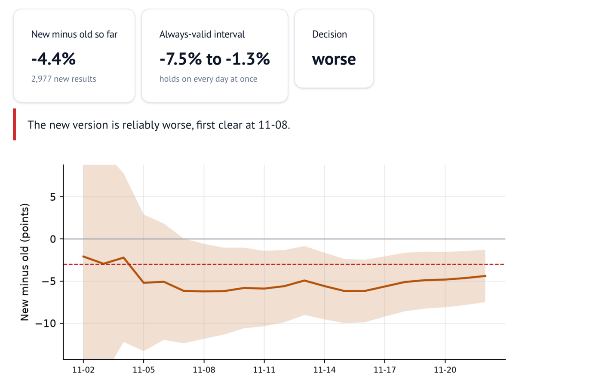

# rolloutwatch

**Did my prompt or model change make things worse?** Watch quality after a change and get an answer as early as the data allows, checking as often as you like without false alarms. With a [calculator that runs in your browser](https://ai-with-md.github.io/rolloutwatch/).

[](https://pypi.org/project/rolloutwatch/)
[](https://github.com/ai-with-md/rolloutwatch/actions/workflows/tests.yml)


[](https://ai-with-md.github.io/rolloutwatch/)

You change a prompt or switch models. Graded production traffic comes in every day: an LLM judge's verdicts, user thumbs up or down, task success. Everyone wants to know as soon as possible whether the change hurt quality, so someone checks the numbers every morning.

That habit quietly breaks the statistics. A significance test promises 5% false alarms if you run it **once**. Run it every day and stop at the first alarm, and with no real change at all:

| Daily checks | False alarm rate of an ordinary test (simulated) |
|---|---|
| 1 | 5% |
| 5 | 14% |
| 10 | 20% |
| 30 | 28% |
| 60 | 34% |

The same happens in the other direction: stop at the first "looks fine" and you will clear changes that are really worse.

rolloutwatch uses an **always-valid** interval for the difference in pass rates. It holds on every day at once, so you can check after every batch, stop the moment it gives an answer, and the 5% still holds.

## Try it

**In the browser:** [ai-with-md.github.io/rolloutwatch](https://ai-with-md.github.io/rolloutwatch/). Paste your daily counts, nothing to install.

**In Python:**

```bash
pip install rolloutwatch
```

No dependencies beyond the standard library. Python 3.9 or newer.

## Use

### Watch a rollout

```python
import rolloutwatch as rw

monitor = rw.QualityMonitor(drop=0.03)   # the smallest drop worth catching: 3 points

# Each day, add that day's graded results for the new and the old version.
reading = monitor.update(new_passed=105, new_total=136, old_passed=138, old_total=165)
print(reading)
# Check 7: new 77.0% (748/971) vs old 83.3% (845/1015). Difference -6.2%
# (always-valid interval -11.9% to -0.6%). WORSE.
```

Every reading says one of three things:

- **worse**: the new version is reliably worse. Roll it back.
- **not worse**: a drop of `drop` or more is ruled out. Safe to keep.
- **keep watching**: not enough data yet to say either.

The chance of any wrong call over the whole rollout stays at or below `alpha` (5% by default), however often you check. Once a decision is made it stands.

**Two ways to run a rollout:**

- **Side by side** (the default): part of the traffic still goes to the old version, and you pass both versions' counts. This is the safer design, because both versions see the same days, the same users and the same kinds of requests.
- **Against a fixed baseline**: everyone gets the new version, and you know the old pass rate well from history: `rw.QualityMonitor(drop=0.03, baseline=0.83)`, then `monitor.update(new_passed, new_total)`. Faster, but a shift in traffic can look like a change in quality.

### From a raw request log

Most teams have a log with one row per graded request rather than daily counts. `load_requests` reads it (CSV, JSON or JSON Lines), counts passes per day or hour for each version, and feeds the monitor:

```python
log = rw.load_requests("requests.csv", new="prompt-v2", old="prompt-v1")
print(log.report())
# Read 5864 requests into 21 periods (time from 'timestamp', version from 'version', outcome from 'judge_verdict').

monitor = rw.QualityMonitor(drop=0.03)
log.feed(monitor)
print(monitor.report().splitlines()[-1])
# The new version is reliably worse, first clear at check 7.
```

- Columns are found by common names: a time (`timestamp`, `date`, `created_at`, ...), a version (`version`, `variant`, `arm`, `group`, ...) and an outcome (`passed`, `success`, `verdict`, `status`, `error`, ...). Name them yourself when the guess is wrong, including nested JSON fields such as `metadata.variant`.
- A numeric judge score works too: `score="judge_score", pass_threshold=0.7`.
- Times can be ISO dates or timestamps, or epoch seconds or milliseconds. Requests are grouped by the date as written, so keep the whole log in one time zone.
- Versions other than `new` and `old` are left out and counted in the report. With `baseline=True`, every row is taken as the new version and the version column is optional.

### Plan before you start

How long until you know depends on your traffic, the size of the change and the design. `plan_rollout` simulates hundreds of rollouts with the same monitor:

```python
print(rw.plan_rollout(baseline=0.82, true_change=-0.04, per_day=300))
# Baseline 82.0%, a real drop of 4.0%, 300 graded requests a day with 50% of traffic on the new version:
#   Answer "worse" in about 11 days (1 in 10 rollouts take 21 or more).
#   Decided within 60 days: 100%. Right call when decided: 100%.

print(rw.plan_rollout(baseline=0.82, true_change=0.0, per_day=300))
#   Answer "not worse" in about 17 days (1 in 10 rollouts take 37 or more). ...
```

Clearing a change that does nothing takes longer than catching one that hurts, because ruling out a drop needs a narrower interval than spotting one.

### See the peeking problem for yourself

```python
rw.peeking_false_alarms(checks=30, per_check=150)   # about 0.29
rw.peeking_curve(max_checks=60)                     # the whole curve
```

## Command line

```bash
rolloutwatch check daily.csv                    # side by side
rolloutwatch check daily.csv --baseline 0.83    # against a fixed baseline
rolloutwatch check requests.csv --new prompt-v2 --old prompt-v1 -v   # a raw request log
rolloutwatch plan --baseline 0.82 --change -0.04 --per-day 300
rolloutwatch peeking --checks 30
```

The CSV has one row per day or batch with `new_passed`, `new_total`, and either `old_passed`, `old_total` or `--baseline`. An optional `date` or `period` column labels the rows:

```
Watching for a drop of 3.0% or more (side by side), chance of any wrong call 0.05:
    2026-11-02  new  78.0%  vs  80.1%  diff  -2.1%  (-26.2% to +22.0%)  keep watching
    ...
    2026-11-07  new  77.0%  vs  83.2%  diff  -6.2%  (-12.4% to +0.0%)  keep watching
    2026-11-08  new  77.0%  vs  83.3%  diff  -6.2%  (-11.9% to -0.6%)  worse
The new version is reliably worse, first clear at date 2026-11-08.
```

For a raw request log, `check` counts the requests per day (or `--period hour`) first; add `--save-counts daily.csv` to keep the counts.

Try it on the simulated rollouts in [`examples/`](https://github.com/ai-with-md/rolloutwatch/tree/main/examples): a prompt change that is really four points worse, run side by side (as daily counts and as the raw log of 5,864 graded requests behind them), and a model switch that changed nothing, checked against a baseline.

## How the numbers are checked

The test suite simulates hundreds of rollouts with a known truth and checks the monitor after every batch, the way people use it:

| Promise | Held in simulation |
|---|---|
| The interval holds on every day at once | 98.8% of rollouts (95% promised) |
| No real change, 60 daily checks: false "worse" calls | 1.0% (an ordinary test: 34%) |
| A real 3 point drop wrongly cleared as "not worse" | 0.5% |
| Fixed baseline, no real change: false "worse" calls | 0.5% |
| Small batches of 15 a day: false "worse" calls | 1.0% |
| A real 6 point drop caught within 60 days | 100% |

The monitor is conservative: it promises 5% and in practice makes fewer wrong calls, at the cost of answering a little later than a method that only had to work for one look. See [`tests/test_simulation.py`](https://github.com/ai-with-md/rolloutwatch/blob/main/tests/test_simulation.py).

## How it works

The interval is a confidence sequence from the normal mixture boundary, the same boundary behind the mixture sequential probability ratio test used in online A/B testing (Johari, Pekelis and Walsh, 2017; Howard, Ramdas, McAuliffe and Sekhon, 2021). For a difference in pass rates with estimated variance V, the half width is

```
sqrt( V (V + t²) / t² × ( 2 log(1/alpha) + log((V + t²) / V) ) )
```

where t is the mixing scale, set to the smallest drop worth catching. The always-valid p-value is the running minimum of one over the mixture likelihood ratio, and the interval and p-value agree exactly. Like most methods for pass rates, it relies on a normal approximation, so the monitor makes no call until each version has a few dozen results (`min_samples`, 50 by default).

## How it compares

- **[confseq](https://github.com/gostevehoward/confseq)** and **[expectation](https://github.com/jakorostami/expectation)** are general libraries for confidence sequences and e-values, with many more methods. rolloutwatch is narrow: one monitor for the question "did this change make quality worse?", with planning and a calculator around it.
- **Experimentation platforms** offer sequential testing for product metrics. rolloutwatch is a small library you can run on any graded LLM traffic, with no platform.
- **LLM observability tools** chart quality over time. rolloutwatch tells you when a difference on that chart is real.

## Limits

- Pass/fail scores only for now. Scores on a scale (1 to 5, or 0 to 1) are a likely next step.
- Results must be independent. If one user sends many requests, or retries are graded separately, group them first.
- The grader must stay the same during the rollout. A new judge prompt or a new judge model changes the scores of both versions.

## Development

```bash
python -m venv .venv
source .venv/bin/activate
pip install -e ".[dev]"
pytest
```

The calculator is a [marimo](https://marimo.io) notebook in [`app/calculator.py`](https://github.com/ai-with-md/rolloutwatch/blob/main/app/calculator.py), published to GitHub Pages as a WebAssembly app on every push to `main`.

## License

MIT
